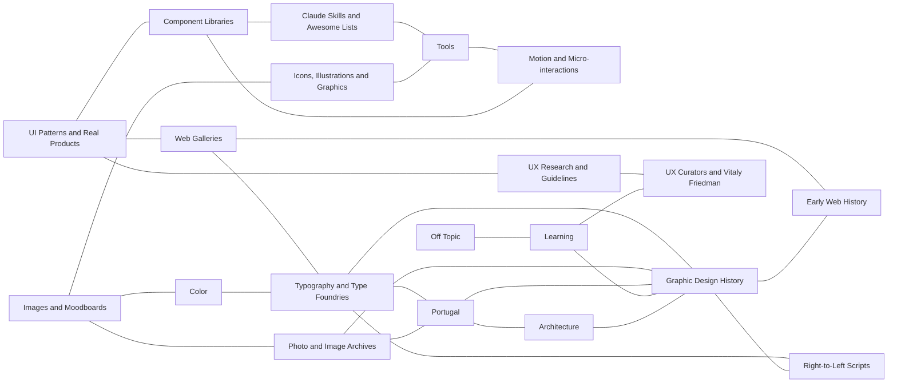

# Knowledge Map

How the topics connect. GitHub renders the diagram below; Obsidian builds the same graph automatically from the links between topic files.

## Open as an Obsidian Vault

1. Clone the repository.
2. In Obsidian choose Open folder as vault and pick the cloned folder.
3. Open Graph view: every topic file is a node, and the Related links are the edges.

Tags in each file's front matter (for example `history`, `portugal`, `rtl`) show up in the tag pane and can colour the graph.

## Planned Topics

- Cinema and title design
- Regions: the Americas, Africa, Oceania, East and South-East Asia, Scotland
- Magazines and newspapers
- Publishers
- Museums
- Online courses
- Artists
- Design awards

[Back to the index](README.md)
